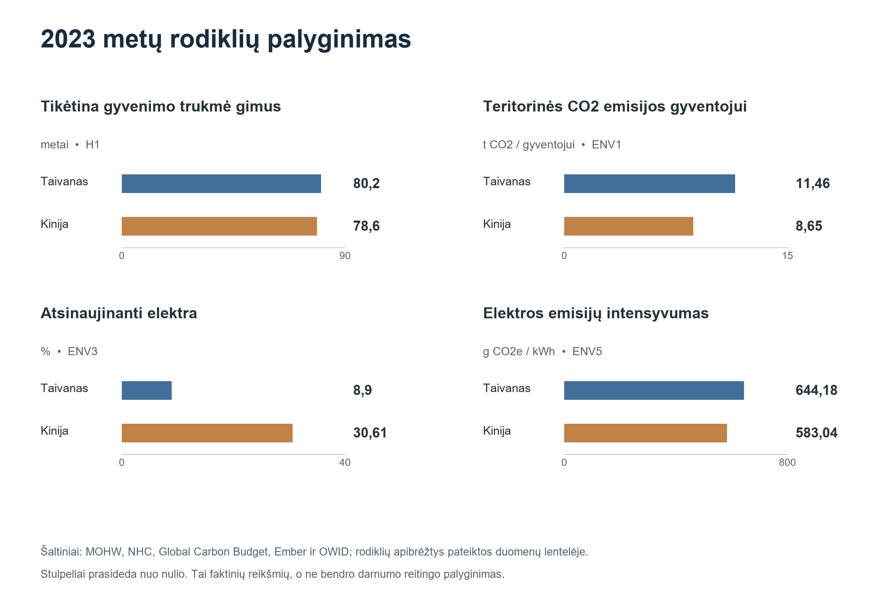
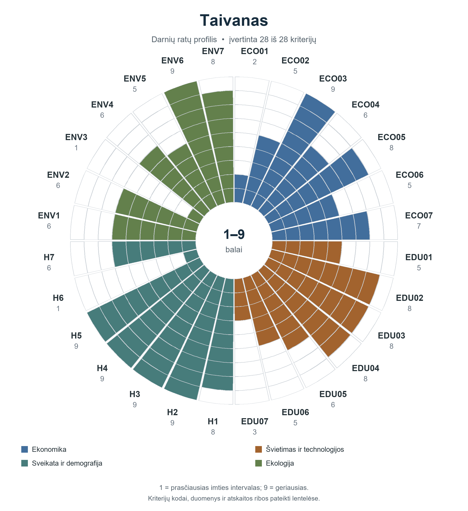
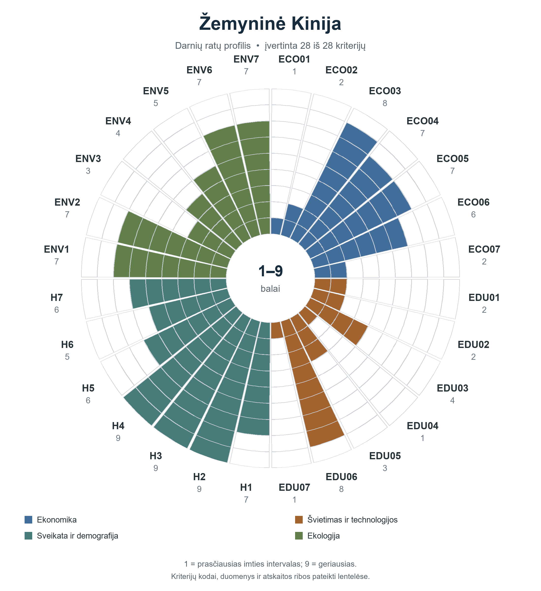

# Taivano ir Kinijos darnios raidos palyginimas

Lietuviškas turinio ir duomenų paketas grupinei DSR užduočiai, parengtas importuoti į **ArcGIS StoryMaps**. Lyginamas Taivanas ir žemyninė Kinija; Honkongo ir Makao duomenys prie Kinijos nepridedami. Duomenų šaltiniai patikrinti 2026-11-25.

**[Atsisiųsti Word dokumentą importui](documents/taivanas-kinija-storymaps.docx?raw=true)** · **[Skaityti pasakojimą](documents/pasakojimas-perziurai.md)** · **[Kaip sudėti StoryMaps](documents/storymaps-importas.md)**

**[Atverti interaktyvius Darnių ratų profilius](https://PovilasJan.github.io/taiwan-china-storymaps/)** · **[Profile Circles naudojimas ir įterpimas](documents/profile-circles.md)**

## Kas paruošta

- Įžanga, tikslas, uždaviniai, Taivano ir Kinijos DVT priemonių apžvalga, analizė bei išvados.
- **28 kriterijai, 56 faktinės reikšmės ir 56 apskaičiuoti balai**: po 7 kriterijus kiekvienai iš keturių sričių.
- Du Darnių ratų paveikslėliai, orientacinis žemėlapis ir keturių rodiklių grafikas.
- „Profile Circles“ papildymas: interaktyvūs ratai su raudona–geltona–žalia balų skale, rodiklių ir šaltinių peržiūra, PNG / SVG eksportu bei dviem paruoštais spalviniais PNG.
- Visų kriterijų šaltiniai, metai, vienetai, skaičiavimo formulės, etalonų imtys ir palyginamumo išlygos.
- Atkuriamas balų skaičiavimas ir dokumento generavimas.



| Taivanas | Žemyninė Kinija |
|---|---|
|  |  |

## Importas

1. Atsisiųskite `documents/taivanas-kinija-storymaps.docx` naudodami aukščiau esančią nuorodą arba GitHub **Download raw file**.
2. StoryMaps pasirinkite **Create → Import document** ir įkelkite DOCX.
3. Patikrinkite tekstą, lenteles, paveikslėlius ir nuorodas. Dokumento importas yra beta funkcija; jis nekuria visų interaktyvių blokų.
4. Pagal [surinkimo instrukciją](documents/storymaps-importas.md) pridėkite žemėlapį, šalių `Sidecar` ir ratų `Swipe`.
5. Įrašykite grupės narių vardus bei pavardes, patikrinkite publikavimo prieigą, pateikite pagal savo seminaro terminą.

Tai paruoštas importo paketas. **Ši saugykla nėra jau paskelbtas StoryMaps pasakojimas**, o DOCX importas neatstoja interaktyvių žemėlapių ir publikavimo.

## Kaip skaityti balus

Taikomi pristatyme nurodyti **9 vienodo pločio intervalai**: `(max − min) / 9`. Neigiamos krypties rodikliai apverčiami. Kiekvienam rodikliui abiem teritorijoms naudojamos vienodos ribos. Metodika, apvalinimas ir tikros etalonų imtys paaiškinti [metodikoje](documents/metodika.md).

Balai nėra oficialus DVT reitingas. 9 reiškia palankiausią konkrečios imties intervalą, ne absoliučią darną. Rodikliai priklauso skirtingiems 2021–2024 metams; kai kurie yra modeliuoti. H5, H6 ir ENV6 turi aiškiai išvardytą 9 regiono ekonomikų etaloną, todėl jų balai nėra pasaulinės vietos. Susijusių rodiklių nesumuojame į bendrą „nugalėtojo“ balą.

Kai vienodas rodiklis abiem teritorijoms pateikiamas skirtingais būdais, tai pažymėta duomenyse ir dokumente. Pavyzdžiui, darbo rinkos bei dalies sveikatos duomenų nacionalinių apklausų ir modelių rezultatai palyginami tik orientaciniam kontekstui. Šaltinių metai nėra leidinių metai.

## Failai

| Vieta | Turinys |
|---|---|
| `documents/taivanas-kinija-storymaps.docx` | Word dokumentas su įterptais paveikslėliais ir šaltinių priedu |
| `documents/pasakojimas-perziurai.md` | Skaitoma turinio versija GitHub |
| `documents/pasakojimas.md` | Generatoriaus turinio šaltinis su lentelių ir paveikslėlių žymomis |
| `documents/storymaps-importas.md` | Konkreti StoryMaps blokų seka ir pristatymo planas |
| `documents/metodika.md` | Intervalų formulės, etalonų imtys ir analizės ribos |
| `documents/profile-circles.md` | Profile Circles adaptacija ir įterpimas į StoryMaps |
| `docs/` | Savarankiškai veikiantis interaktyvus puslapis, publikuojamas per GitHub Pages |
| `data/indicators.json` | 28 rodikliai, šaltiniai, 56 balai ir tikros etalonų reikšmės |
| `data/policy-sources.json` | DVT priemonių ir pasakojimo šaltiniai |
| `assets/` | Originalios šio darbo vizualizacijos |
| `scripts/` | Skaičiavimo, generavimo ir tikrinimo kodas |

## Atkurti

Reikia Python 3.11 ar naujesnio. Įdiegę `requirements.txt` priklausomybes, projekto kataloge vykdykite:

```bash
python scripts/score.py
python scripts/build.py
python scripts/build_interactive_data.py
python scripts/build_profile_circles.py
python scripts/validate.py
python scripts/validate_circles.py
```

Skaičiavimams pakanka saugykloje išsaugotų etalonų ištraukų; šaltinių duomenys automatiškai neperrašomi naujesnėmis versijomis. Paveikslėlių šriftai gali nežymiai skirtis skirtingose operacinėse sistemose.

## Šaltiniai ir kilmė

Naudoti nacionaliniai Taivano ir Kinijos statistikos šaltiniai, World Bank / ILO, UNDP Human Development Report, Penn World Table 11.0, švietimo lyginamosios lentelės, Global Carbon Budget, Ember, OWID ir IHME. Tikslios nuorodos yra prie kiekvieno rodiklio. Natural Earth žemėlapio duomenys yra public domain.

IHME grafikams naudota nedidelė cituojamų viešai rodomų faktinių reikšmių imtis; visas riboto platinimo pirminis duomenų rinkinys čia neperpublikuojamas. Originalūs dėstytojo PDF, kitos grupės turinys ir pilni statistikos leidiniai į šią saugyklą neįtraukti. Šaltinių duomenims galioja jų teikėjų sąlygos; visam rinkiniui nesuteikiama bendroji licencija, kuri jas pakeistų.

Interaktyvių ratų sandara ir balų spalvų principas pritaikyti iš [Circles of Sustainability — Profile Circles](https://www.circlesofsustainability.com/circles-overview/profile-circles/). Naudojamos užduoties keturios sritys. Spalvos nurodo atskaitos intervalus, o ne originalaus metodo kokybines darnumo būsenas. Braižymo kodas ir paveikslėliai sukurti šiam projektui.

[Kitos grupės pavyzdys](https://storymaps.arcgis.com/stories/7718e245bd354f858c83632492a7c3f5) naudotas tik pagrindinių dalių ir StoryMaps blokų sekai suprasti. Šio darbo tekstas, lentelės ir grafikai parengti atskirai. Turinys parengtas su AI pagalba; skaičiavimai atkuriami, šaltiniai ir jų ribos atskleisti.
