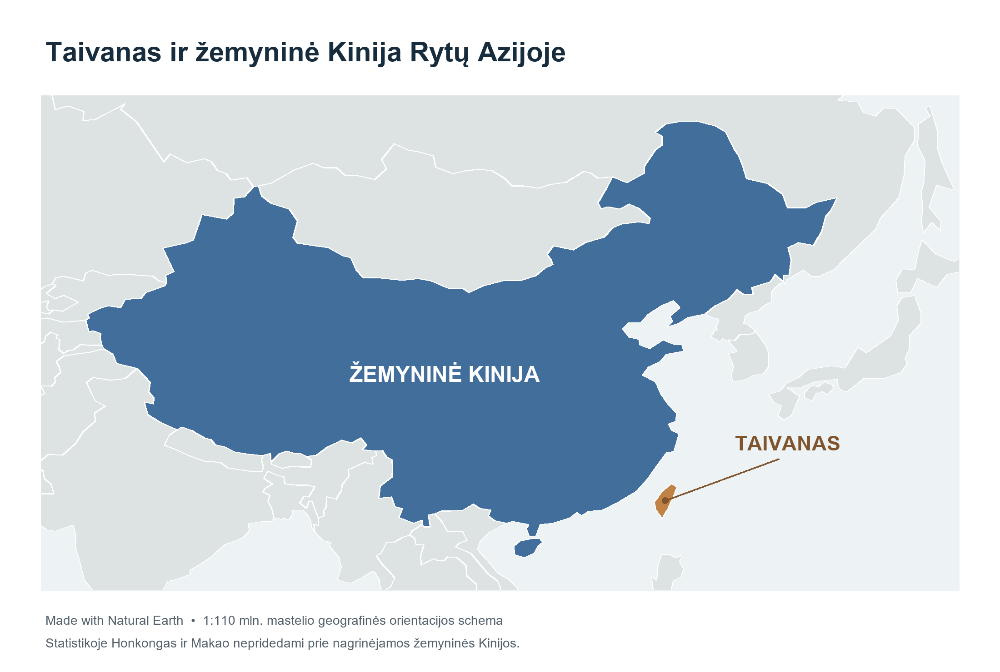
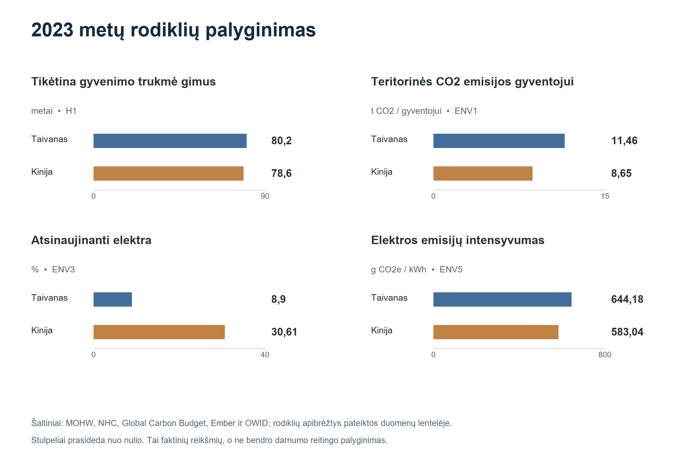
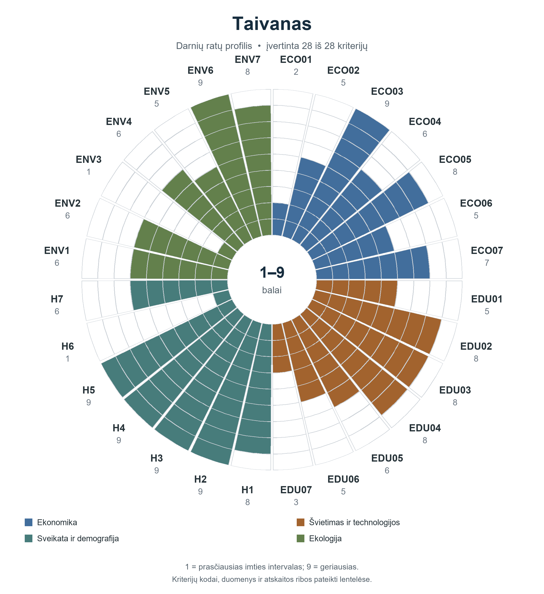
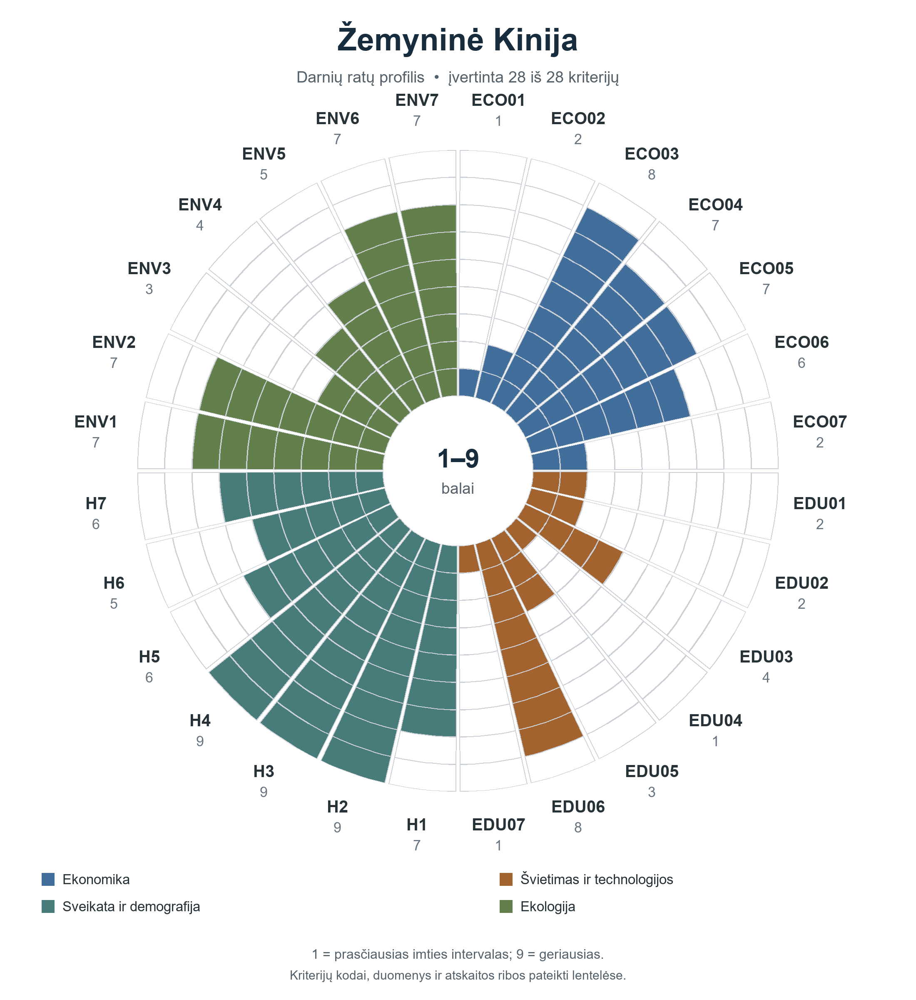

# Taivano ir Kinijos darnios raidos palyginimas

## Įžanga

Taivano ir žemyninės Kinijos palyginimas rodo, kad ekonominiai ir technologiniai pajėgumai gali derėti su skirtingais socialiniais bei aplinkos rezultatais. Taivano BVP vienam gyventojui, darbo našumas ir kai kurie mokslo išteklių rodikliai aukštesni. Kinijoje didesnė atsinaujinančių išteklių dalis elektros gamyboje, nors ir anglies dalis tebėra didesnė. Šie skirtingi rezultatai pagrindžia keturių sričių analizę, kurioje ekonominė pažanga vertinama kartu su gyventojų gerove ir aplinkos kaina. [ECO01, ECO02, EDU04, EDU05, ENV3, ENV4]

Pasirinkimą pagrindžia geografinis artumas Rytų Azijoje ir galimybė palyginti du skirtingo masto pramonės bei technologijų vystymosi atvejus. Darbe Kinija reiškia žemyninę Kiniją, be Honkongo, Makao ir Taivano. Taivanas nagrinėjamas kaip atskiras statistinis vienetas. Atskirų šaltinių geografinės aprėpties išlygos pateiktos prie rodiklių.

Darbo tikslas yra nustatyti, kaip abiejose teritorijose ekonominiai ir technologiniai pasiekimai dera su sveikatos bei ekologijos rezultatais. Uždaviniai: apžvelgti DVT priemones, palyginti 28 kriterijus, parengti du Darnius ratus ir pagrįsti svarbiausius tolesnės pažangos prioritetus.

## Taivanas

Taivano 2022 m. savanoriškoje nacionalinėje apžvalgoje aptariama 18 vietos sąlygoms pritaikytų T-SDG tikslų. Tai vietinė sistema; Jungtinės Tautos turi 17 DVT. Taivano priemonės apima socialinę apsaugą, visuotinę sveikatos priežiūrą, regionų gaivinimą, žaliąją energetiką ir žiedinę ekonomiką. Vietos savivaldybių apžvalgos papildo nacionalinį vertinimą. [P01, P02]

Nacionalinis sveikatos draudimas, pagal 2025 m. oficialią apžvalgą, apima apie 99,9 proc. piliečių. Ilgalaikės priežiūros programos Long term Care 2.0 paslaugomis 2024 m. naudojosi 757 089 žmonės. Šie duomenys rodo paslaugų mastą, tačiau vien draudimo ar paslaugų aprėptis neįrodo vienodos kokybės ir finansinės apsaugos visiems gyventojams. [P08, P10]

Švietimo priemonės orientuotos į prieinamą ikimokyklinį ugdymą, 12 metų ugdymo programų įgyvendinimą, skaitmeninį mokymąsi ir pagalbą atokių vietovių mokiniams. Klimato politikoje numatytas nulinis grynasis išmetamųjų teršalų kiekis iki 2050 m. Priemonės apima atsinaujinančią energetiką, energijos efektyvumą, elektros tinklus, kaupimą ir teisingą pertvarką. [P06, P11]

## Kinija

Pasaulinį kontekstą papildo 2025 m. UNDP Žmogaus raidos ataskaita. Joje Kinijos 2023 m. žmogaus raidos indeksas yra 0,797. Šis suvestinis rodiklis apjungia sveikatos, mokymosi ir pajamų aspektus; mūsų keturių sričių palyginime papildomai nagrinėjama ekologinė raidos kaina. [P13]

Kinijos 2021 m. savanoriškoje 2030 m. darbotvarkės apžvalgoje išskirtos skurdo mažinimo, ekonomikos atsigavimo ir tarptautinio bendradarbiavimo kryptys. Pasaulio banko ir Kinijos institucijų 2022 m. tyrimas nustatė, kad per ankstesnius keturis dešimtmečius žmonių, gyvenusių žemiau tuometinės 1,90 JAV dolerio per dieną ribos pagal 2011 m. PGP, skaičius sumažėjo beveik 800 milijonų. Tai istorinis pažangos įvertis, o ne dabartinės skurdo ribos taikymas. [P03, P04]

Socialiniai skirtumai išlieka. 2024 m. miesto ir kaimo disponuojamųjų pajamų vienam gyventojui santykis buvo 2,34. Bazinio medicininio draudimo aprėptis tais metais siekė maždaug 95 proc. Vien aprėpties rodiklis neparodo pacientų išlaidų, gydymo kokybės ar regioninių paslaugų skirtumų. [P05, P09]

Oficialioje 2024 m. suvestinėje devynmečio privalomojo mokymo išlaikymo rodiklis siekė 95,9 proc. Klimato politikoje numatytas CO₂ išmetimo pikas iki 2030 m. ir anglies neutralumas iki 2060 m. Šių priemonių veiksmingumą reikia tikrinti faktiniais švietimo, energijos ir emisijų duomenimis; planų datos savaime nėra pasiekimų įrodymas. [P07, P12]

## Rodiklių palyginimas

Kiekvienai sričiai parinkti septyni vienodi kriterijai abiem teritorijoms. Naudojami 2021–2024 m. duomenys: konkrečios poros ir jos etalono metai derinami, o visų metų reikšmės nesuplakamos į tariamą 2026 m. pjūvį. Pirmenybė teikiama tai pačiai tarptautinei serijai. Kai Taivano nacionaliniai duomenys lyginami su modeliuotais tarptautiniais įverčiais, palyginimas pažymimas kaip orientacinis.

### Ekonomika

Nominalus BVP vienam gyventojui 2024 m. Taivane siekė 34 040 JAV dolerių, Kinijoje apie 13 293. Tai gamybos vertės, o ne namų ūkių disponuojamųjų pajamų matas. PWT 2023 m. darbo našumo rodiklis Taivane taip pat aukštesnis. Vartojimo kriterijus apima namų ūkių ir valdžios vartojimą; jo negalima vadinti vien vidutinio gyventojo asmeninėmis išlaidomis. [ECO01, ECO02, ECO07]

Kinijos užimtumo ir moterų ekonominio aktyvumo rodikliai aukštesni, tačiau dalyvavimas darbo rinkoje pats savaime neparodo atlygio, saugumo ar darbo kokybės. Darbo pajamų dalis nusako pajamų paskirstymą darbui ir kapitalui, o ne nelygybę tarp namų ūkių. Todėl ekonominę pažangą siejame su DVT 8 ir 10, išlaikydami darbo kokybės bei regioninių skirtumų klausimą. [ECO04, ECO05, ECO06, P05]

| Kodas ir rodiklis | Vienetas | Taivanas | Metai | Kinija | Metai |
|---|---|---:|---|---:|---|
| ECO01 BVP vienam gyventojui | einamieji JAV USD | 34 040 | 2024 | 13 293,12 | 2024 |
| ECO02 Darbo našumas: realusis BVP vienam dirbančiajam | 2021 JAV USD pagal einamuosius PGP / dirbančiajam | 123 929,33 | 2023 | 41 124,65 | 2023 |
| ECO03 Nedarbo lygis | % darbo jėgos | 3,38 | 2024 | 4,59 | 2024 |
| ECO04 Moterų dalyvavimas darbo rinkoje nuo 15 metų | % moterų, 15 metų ir vyresnių | 51,95 | 2024 | 59,45 | 2024 |
| ECO05 Darbo pajamų dalis BVP | % | 65,09 | 2023 | 56,12 | 2023 |
| ECO06 Užimtųjų dalis tarp 15 metų ir vyresnių gyventojų | % | 57,3 | 2024 | 61,93 | 2024 |
| ECO07 Realusis namų ūkių ir valdžios vartojimas vienam gyventojui | 2021 JAV USD pagal einamuosius PGP / gyventojui | 41 504,89 | 2023 | 11 619,77 | 2023 |

### Švietimas ir technologijos

Bendroje 2022 m. lyginamojoje lentelėje aukštojo mokslo GER yra 88,9 proc. Taivane ir 72,0 proc. Kinijoje, o 25 metų ir vyresnių gyventojų vidutinė mokymosi trukmė atitinkamai 12,6 ir 8,1 metų. GER gali viršyti 100 proc., nes skaitiklis nėra apribotas vien teorinės amžiaus grupės studentais. [EDU01, EDU02]

2021 m. Taivano MTEP išlaidos siekė 3,8 proc. BVP, Kinijos 2,4 proc. Kartu vertinami tyrėjų intensyvumas ir mokslo publikacijos. Tai mokslo pajėgumų požymiai, tačiau publikacijų skaičius neįrodo jų kokybės ar praktinio poveikio. Fiksuoto plačiajuosčio ryšio prenumeratų skaičius taip pat nėra unikalių interneto vartotojų dalis. Šie skirtumai svarbūs DVT 4 ir 9 interpretacijai. [EDU04–EDU07]

| Kodas ir rodiklis | Vienetas | Taivanas | Metai | Kinija | Metai |
|---|---|---:|---|---:|---|
| EDU01 Aukštojo mokslo bendrasis įtraukties rodiklis (GER) | % | 88,9 | 2022 | 72 | 2022 |
| EDU02 Vidutinė mokymosi trukmė tarp 25 metų ir vyresnių | metai | 12,6 | 2022 | 8,1 | 2022 |
| EDU03 Pradinio ugdymo mokiniai vienam mokytojui | mokinių/mokytoją | 12,1 | 2021 | 16,33 | 2021 |
| EDU04 Tyrėjai (viso etato ekvivalentais) | tyrėjų FTE / 1 000 užimtųjų | 14,7 | 2021 | 3,2 | 2021 |
| EDU05 MTEP išlaidos | % BVP | 3,8 | 2021 | 2,4 | 2021 |
| EDU06 Fiksuoto plačiajuosčio ryšio prenumeratos | 100 gyventojų | 30,19 | 2024 | 47,19 | 2024 |
| EDU07 SCIE mokslinės publikacijos | publikacijų/1mln.gyv. | 1 560,64 | 2022 | 535,34 | 2022 |

### Sveikata ir demografija

2023 m. tikėtina gyvenimo trukmė gimus buvo 80,2 metų Taivane ir 78,6 metų Kinijoje. Kūdikių mirtingumas siekė 4,3 ir 4,5 mirčių tūkstančiui gyvų gimusiųjų; toks mažas skirtumas neleidžia daryti tvirtos priežastinės išvados apie vienos sistemos pranašumą. Kūdikių, naujagimių ir vaikų iki penkerių metų mirtingumas persidengia. [H1–H4]

Amžiumi standartizuoti IHME įverčiai atskleidžia skirtingą ligų naštą. Širdies ir kraujagyslių ligų mirtingumas didesnis Kinijoje, o vėžio mirtingumas šiame rinkinyje didesnis Taivane. Amžiaus standartizavimas leidžia palyginti populiacijas sumažinant jų amžiaus struktūros įtaką. Šie modeliuoti įverčiai turi paklaidą; jų negalima tapatinti su neapdorotais nacionalinių registrų rodikliais. Ligoninių lovų skaičius rodo stacionaro talpą, bet ne gydymo kokybę. [H5–H7]

| Kodas ir rodiklis | Vienetas | Taivanas | Metai | Kinija | Metai |
|---|---|---:|---|---:|---|
| H1 Tikėtina gyvenimo trukmė gimus | metai | 80,2 | 2023 | 78,6 | 2023 |
| H2 Kūdikių mirtingumas | mirčių / 1 000 gyvų gimusiųjų | 4,3 | 2023 | 4,5 | 2023 |
| H3 Vaikų iki penkerių metų mirtingumas | mirčių / 1 000 gyvų gimusiųjų | 5,1 | 2023 | 6,2 | 2023 |
| H4 Naujagimių mirtingumas | mirčių / 1 000 gyvų gimusiųjų | 2,8 | 2023 | 2,8 | 2023 |
| H5 Mirtingumas nuo širdies ir kraujagyslių ligų | amžiumi standartizuotos mirtys / 100 000 gyventojų | 87,7 | 2023 | 208 | 2023 |
| H6 Mirtingumas nuo vėžio | amžiumi standartizuotos mirtys / 100 000 gyventojų | 142,7 | 2023 | 113 | 2023 |
| H7 Ligoninių lovos | lovos / 1 000 gyventojų | 5,92 | 2023 | 5,68 | 2023 |

### Ekologija

2023 m. Taivano teritorinės CO₂ emisijos vienam gyventojui buvo apie 11,46 t, Kinijos 8,65 t. Įvertinus prekyboje įkūnytas emisijas, vartojimu pagrįstos reikšmės buvo 12,65 ir 7,67 t. Tai parodo, kodėl svarbu nagrinėti abi apskaitos perspektyvas. [ENV1, ENV2]

Atsinaujinantys ištekliai sudarė apie 8,90 proc. Taivano ir 30,61 proc. Kinijos elektros gamybos. Anglies dalis buvo atitinkamai 43,08 ir 60,83 proc. Didesnė atsinaujinančių išteklių dalis neleidžia savaime spręsti apie visą likusią gamybos struktūrą. Elektros gyvavimo ciklo emisijų intensyvumas buvo 644,18 ir 583,04 g CO₂e/kWh. [ENV3–ENV5]

Profilį papildo oro taršai priskiriamas amžiumi standartizuotas mirtingumas ir pirminės energijos sąnaudos vienam BVP vienetui. Aplinkos analizė orientuota į klimatą, energetiką ir oro taršą. Ji neaprėpia visos biologinės įvairovės, vandens ar atliekų būklės. Susijusių emisijų rodiklių nesumuojame į vieną tariamai nepriklausomą ekologijos reitingą. [ENV6, ENV7]

| Kodas ir rodiklis | Vienetas | Taivanas | Metai | Kinija | Metai |
|---|---|---:|---|---:|---|
| ENV1 Teritorinės CO₂ emisijos vienam gyventojui | t CO₂ / gyventojui | 11,46 | 2023 | 8,65 | 2023 |
| ENV2 Vartojimu pagrįstos CO₂ emisijos vienam gyventojui | t CO₂ / gyventojui | 12,65 | 2023 | 7,67 | 2023 |
| ENV3 Atsinaujinančių išteklių dalis elektros gamyboje | % | 8,9 | 2023 | 30,61 | 2023 |
| ENV4 Anglies dalis elektros gamyboje | % | 43,08 | 2023 | 60,83 | 2023 |
| ENV5 Elektros gamybos gyvavimo ciklo emisijų intensyvumas | g CO₂e / kWh | 644,18 | 2023 | 583,04 | 2023 |
| ENV6 Mirtingumas, priskiriamas oro taršai | amžiumi standartizuotos mirtys / 100 000 gyventojų | 31,1 | 2023 | 94,6 | 2023 |
| ENV7 Pirminės energijos intensyvumas | kWh / PGP dolerį 2011 m. kainomis | 1,05 | 2022 | 1,65 | 2022 |

## Darnūs ratai

Taikomas užduoties pristatyme aprašytas devynių vienodo pločio intervalų metodas. Kiekvieno rodiklio atskaitos maksimumo ir minimumo skirtumas padalijamas iš devynių. Kai didesnė reikšmė palankesnė pasirinktam kriterijui, balas didėja kylant reikšmei; mirtingumo, emisijų, nedarbo, mokinių ir mokytojų santykio bei energijos intensyvumo skalės apverčiamos. Vidinė riba priskiriama žemesniam balui; kraštiniai rezultatai ribojami nuo 1 iki 9. Skaičiavimų kodas ir visos etalonų reikšmės pateikti kartu su darbu.

Atskaitos imtys skiriasi pagal duomenų prieinamumą: naudojamos pasaulinės WDI, PWT ir energijos serijos, švietimo lyginamųjų lentelių imtys bei devynių pasirinktų Rytų ir Pietryčių Azijos ekonomikų imtis H5, H6 ir ENV6 rodikliams. Pastarąją sudaro Taivanas, Kinija, Japonija, Pietų Korėja, Singapūras, Tailandas, Vietnamas, Malaizija ir Mianmaras. Tai tikslinė, o ne visą regioną reprezentuojanti imtis. Kiekvieno kriterijaus ribos ir imties dydis pateikti priede.

Balas 9 reiškia palankiausią pasirinktos imties intervalą, o ne absoliučiai pasiektą DVT. Balas 1 taip pat nereiškia prasčiausio rezultato pasaulyje. Nacionalinių ir modeliuotų serijų skirtumai, duomenų apvalinimas bei ekstremalios etalonų reikšmės gali pakeisti intervalo balą. Dėl šių priežasčių neapskaičiuojame bendro ar sričių vidutinio balo; lyginame konkrečius kriterijus ir jų faktines reikšmes.

## Išvados

Pasirinkti duomenys rodo, kad Taivano stiprybės yra ekonominis našumas ir dalis švietimo bei mokslo pajėgumų. Sveikatos rezultatai nevienodi: ilgesnė gyvenimo trukmė ir mažesnis modeliuotas širdies bei kraujagyslių ligų mirtingumas dera su didesniu modeliuotu vėžio mirtingumu nei Kinijoje. Aukštesnis ekonominis pajėgumas taip pat dera su didesnėmis CO₂ emisijomis gyventojui. Todėl Taivanui aktualios DVT 3, 7, 12 ir 13 sąsajos: prevencija, prieinama ilgalaikė priežiūra ir mažesnė energijos bei vartojimo klimato kaina.

Kinijoje didesnė atsinaujinančios elektros dalis ir platesnis fiksuoto plačiajuosčio ryšio prenumeratų paplitimas dera su žemesniais nagrinėjamais našumo bei mokymosi trukmės rodikliais. Aktualūs DVT 3, 4, 8 ir 10 uždaviniai: mažinti regioninius paslaugų ir pajamų skirtumus, stiprinti prevenciją bei gerinti darbo ir ugdymo kokybę. Anglies vaidmuo elektros gamyboje išlaiko DVT 7 ir 13 svarbą.

Abi teritorijos turi pažangos ir probleminių sričių. Šis profilis padeda nustatyti konkrečius prioritetus, tačiau iš jo negalima paskelbti vienos teritorijos visapusiškai darnesne. Programų veiksmingumui patikimiau vertinti reikėtų vienodai apibrėžtų rodiklių kelių metų eilučių ir regioninių bei socialinių grupių analizės.

## Literatūra

- [P01] National Council for Sustainable Development. (2022). Taiwan's Voluntary National Review. https://ncsd.ndc.gov.tw/_ofu/download/Vhome/2022%20Taiwan%27s%20Voluntary%20National%20Review.pdf

- [P02] National Council for Sustainable Development. Taiwan's Voluntary National Review and Voluntary Local Reviews. https://ncsd.ndc.gov.tw/Fore/en/Achievements

- [P03] Permanent Mission of the People's Republic of China to the UN. (2021 m. liepos 14 d.). Work Together to Open Up New Prospects for International Development Cooperation. https://un.china-mission.gov.cn/eng/chinaandun/economicdevelopment/sfz/202107/t20210715_9126882.htm

- [P04] World Bank. (2022 m. balandžio 1 d.). Lifting 800 Million People Out of Poverty. https://www.worldbank.org/en/news/press-release/2022/04/01/lifting-800-million-people-out-of-poverty-new-report-looks-at-lessons-from-china-s-experience

- [P05] National Bureau of Statistics of China. (2025 m. rugsėjo 28 d.). Social development and people's livelihoods during the 14th Five-Year Plan. https://www.stats.gov.cn/sj/zxfbhjd/202509/t20250928_1961404.html

- [P06] Ministry of Education Taiwan. (2023 m. birželio 19 d.). Ministry of Education Objectives for 2024. https://english.moe.gov.tw/cp-9-36273-67538-1.html

- [P07] National Bureau of Statistics of China. (2025 m. vasario 28 d.). Statistical Communiqué on the 2024 National Economic and Social Development. https://www.stats.gov.cn/english/PressRelease/202502/t20250228_1958822.html

- [P08] Executive Yuan Taiwan. (2025 m. rugsėjo 3 d.). National Health Insurance. https://www.ey.gov.tw/state/A01F61B9E9A9758D/a8110473-da2f-4c3f-84da-aeebbd92aab9

- [P09] National Healthcare Security Administration China. (2025 m. liepos 14 d.). Statistical bulletin on healthcare security development in 2024. https://app.www.gov.cn/govdata/gov/202507/14/532768/article.html

- [P10] Ministry of Justice Taiwan. Fourth Report on the Implementation of the International Covenant on Economic Social and Cultural Rights. https://www.humanrights.moj.gov.tw/media/20214875/03%E8%8B%B1%E6%96%87%E7%89%88-implementation-of-the-international-covenant-on-economic-social-and-cultural-rights.pdf?mediaDL=true

- [P11] Climate Change Administration Taiwan. Net Zero Roadmap. https://www.cca.gov.tw/en/climatetalks/net-zero-roadmap/1891.html

- [P12] State Council Information Office China. (2025 m. lapkričio 8 d.). Carbon Peaking and Carbon Neutrality China's Plans and Solutions. https://english.www.gov.cn/archive/whitepaper/202511/08/content_WS690ee812c6d00ca5f9a076cd.html

- [P13] United Nations Development Programme. (2025). Human Development Report 2025. https://hdr.undp.org/content/human-development-report-2025

- [M01] Natural Earth. Admin 0 Countries 1:110m. https://www.naturalearthdata.com/about/terms-of-use/

- Rodiklių pirminiai šaltiniai, etalonų sudėtis ir skaičiavimo formulės pateikti tolesniame priede bei data/indicators.json. Šaltiniai tikrinti 2026 m. lapkričio 25 d.

## Rodiklių šaltiniai

**ECO01 BVP vienam gyventojui.** [Taivano šaltinis](https://ws.dgbas.gov.tw/001/Upload/464/ebook/ebook_336584/pdf/full.pdf); [Kinijos šaltinis](https://api.worldbank.org/v2/country/CHN/indicator/NY.GDP.PCAP.CD?format=json&date=2024). Abu nominalūs BVP vienam gyventojui JAV doleriais. Valiutos kursai ir šaltinių revizijų datos skiriasi; tai nėra perkamosios galios ar namų ūkių pajamų rodiklis.

**ECO02 Darbo našumas: realusis BVP vienam dirbančiajam.** [Taivano šaltinis](https://doi.org/10.34894/FABVLR); [Kinijos šaltinis](https://doi.org/10.34894/FABVLR). Tos pačios PWT versijos, metų ir metodikos abiejų ekonomikų įverčiai; PGP leidžia lyginti kainų lygius. Tai nėra nominalūs JAV doleriai.

**ECO03 Nedarbo lygis.** [Taivano šaltinis](https://www.moea.gov.tw/MNS/DOS_E/content/wHandMenuFile.ashx?file_id=38665); [Kinijos šaltinis](https://api.worldbank.org/v2/country/CHN/indicator/SL.UEM.TOTL.ZS?format=json&date=2024). Taivano nacionalinė 15+ darbo jėgos apklausa lyginama su Kinijos ILO modeliuotu 15+ visos ekonomikos įverčiu. Tai nėra Kinijos vien miestų nedarbo rodiklis. Apklausos ir modeliavimo skirtumas išlieka.

**ECO04 Moterų dalyvavimas darbo rinkoje nuo 15 metų.** [Taivano šaltinis](https://gec.ey.gov.tw/File/4B44A10A9095533C?A=C); [Kinijos šaltinis](https://api.worldbank.org/v2/country/CHN/indicator/SL.TLF.CACT.FE.ZS?format=json&date=2024). Vienoda 15+ amžiaus sąvoka, bet Taivanas: apklausa, Kinija: ILO modeliuotas įvertis. Nėra darbo kokybės matas.

**ECO05 Darbo pajamų dalis BVP.** [Taivano šaltinis](https://doi.org/10.34894/FABVLR); [Kinijos šaltinis](https://doi.org/10.34894/FABVLR). Ta pati PWT11.0 metodika ir2023metai; darbo pajamų dalis nacionalinėmis einamosiomis kainomis, ne PGP dydis. Tai funkcinis pajamų paskirstymas darbui, ne namų ūkių pajamų nelygybės matas.

**ECO06 Užimtųjų dalis tarp 15 metų ir vyresnių gyventojų.** [Taivano šaltinis](https://english.mol.gov.tw/media/r5xjinns/5-population-total-employment-and-employment-population-ratios-2024-%E8%A1%A83-2.pdf); [Kinijos šaltinis](https://data.worldbank.org/indicator/SL.EMP.TOTL.SP.ZS?locations=CN). Abu rodikliai apima 15+ amžiaus grupę, tačiau Taivano vertė iš nacionalinės civilinių gyventojų apklausos, Kinijos ir kitų atskaitos ekonomikų – ILO modeliuoti įverčiai. Taivano teritorinė ir gyventojų aprėptis nevisiškai sutampa su modelio sąvoka; palyginimas apytikris.

**ECO07 Realusis namų ūkių ir valdžios vartojimas vienam gyventojui.** [Taivano šaltinis](https://doi.org/10.34894/FABVLR); [Kinijos šaltinis](https://doi.org/10.34894/FABVLR). Tos pačios PWT versijos, metų ir metodikos abiejų ekonomikų įverčiai; PGP leidžia lyginti kainų lygius. Tai nėra nominalūs JAV doleriai.

**EDU01 Aukštojo mokslo bendrasis įtraukties rodiklis (GER).** [Taivano šaltinis](https://stats.moe.gov.tw/files/ebook/International_Comparison/2024/i2024_1-1.ods); [Kinijos šaltinis](https://stats.moe.gov.tw/files/ebook/International_Comparison/2024/i2024_1-1.ods). Abi reikšmės iš tos pačios UNESCO duomenimis grįstos lentelės; GER nėra tikimybė ir gali viršyti100%.

**EDU02 Vidutinė mokymosi trukmė tarp 25 metų ir vyresnių.** [Taivano šaltinis](https://stats.moe.gov.tw/files/ebook/International_Comparison/2024/i2024_3-4.ods); [Kinijos šaltinis](https://stats.moe.gov.tw/files/ebook/International_Comparison/2024/i2024_3-4.ods). Suderinta 25 metų ir vyresnių amžiaus grupė ir 2022 m. duomenys; rodiklis matuoja sukauptą formalų išsilavinimą, ne dabartinę ugdymo kokybę.

**EDU03 Pradinio ugdymo mokiniai vienam mokytojui.** [Taivano šaltinis](https://stats.moe.gov.tw/files/ebook/International_Comparison/2024/i2024_2-1.ods); [Kinijos šaltinis](https://www.moe.gov.cn/jyb_sjzl/sjzl_fztjgb/202209/t20220914_660850.html). Visi duomenys yra 2021 m., pradinio ugdymo pakopos. Galimi Taivano ir OECD bei Kinijos nacionalinio šaltinio darbo krūvio ir mokytojų klasifikavimo skirtumai; rodiklis matuoja išteklius, ne klasės dydį.

**EDU04 Tyrėjai (viso etato ekvivalentais).** [Taivano šaltinis](https://stats.moe.gov.tw/files/ebook/International_Comparison/2024/i2024_3-20.ods); [Kinijos šaltinis](https://stats.moe.gov.tw/files/ebook/International_Comparison/2024/i2024_3-20.ods). Ta pati lentelė ir 2021 m. duomenys; tyrėjai perskaičiuoti į viso etato ekvivalentus. Vardiklis yra užimtieji, ne visi gyventojai.

**EDU05 MTEP išlaidos.** [Taivano šaltinis](https://stats.moe.gov.tw/files/ebook/International_Comparison/2024/i2024_4-7.ods); [Kinijos šaltinis](https://stats.moe.gov.tw/files/ebook/International_Comparison/2024/i2024_4-7.ods). Sąmoningai naudojami senesni 2021 m. duomenys: abiem šalims ir visai atskaitos imčiai ta pati lentelė bei metai. Nepainioti su vien civilinių MTEP išlaidų stulpeliu.

**EDU06 Fiksuoto plačiajuosčio ryšio prenumeratos.** [Taivano šaltinis](https://api.ncc.gov.tw/enncc/app/data/doc?aplistdn=undefined&detailNo=1450658952860667904&id=53&module=commonMessage53&preview=undefined&serno=baf54563-a2a2-47a5-b670-c326879cb3df&type=s); [Kinijos šaltinis](https://api.worldbank.org/v2/country/CHN/indicator/IT.NET.BBND.P2?format=json&date=2024). Prenumeratos nėra unikalūs žmonės ar interneto vartotojų procentas; viena linija gali aptarnauti kelis gyventojus.

**EDU07 SCIE mokslinės publikacijos.** [Taivano šaltinis](https://stats.moe.gov.tw/files/ebook/International_Comparison/2024/i2024_3-16.ods); [Kinijos šaltinis](https://stats.moe.gov.tw/files/ebook/International_Comparison/2024/i2024_3-16.ods). Bendras 2022 m. mokslinių publikacijų šaltinis ir atitinkamų 2022 m. gyventojų skaičius. Rodiklis matuoja mokslinės veiklos intensyvumą, ne darbų kokybę; Taivano registruotų gyventojų ir WDI gyventojų skaičiaus aprėpties skirtumas išlieka.

**H1 Tikėtina gyvenimo trukmė gimus.** [Taivano šaltinis](https://service.mohw.gov.tw/ebook/dopl/113/02/files/basic-html/page173.html); [Kinijos šaltinis](https://en.nhc.gov.cn/2024-08/30/c_86340.htm). Nacionaliniai abiejų šalių 2023 m. įverčiai. Taivano ataskaitoje reikšmė suapvalinta iki dešimtosios. Pasaulio banko modeliuoti įverčiai gali skirtis nuo nacionalinių; keičiant šaltinį būtina tai nurodyti.

**H2 Kūdikių mirtingumas.** [Taivano šaltinis](https://service.mohw.gov.tw/ebook/dopl/113/02/files/basic-html/page177.html); [Kinijos šaltinis](https://www.gov.cn/lianbo/bumen/202408/P020240829729470466631.pdf). Mirtys iki pirmojo gimtadienio. Registravimo ir stebėsenos metodai gali skirtis; mažas skirtumas nėra priežastinio sistemos veiksmingumo įrodymas.

**H3 Vaikų iki penkerių metų mirtingumas.** [Taivano šaltinis](https://service.mohw.gov.tw/ebook/dopl/113/02/files/basic-html/page173.html); [Kinijos šaltinis](https://www.gov.cn/lianbo/bumen/202408/P020240829729470466631.pdf). 2023 m. nacionaliniai rodikliai. Susijęs su kūdikių ir naujagimių mirtingumu, todėl bendras vidurkis šią temą įvertintų kelis kartus.

**H4 Naujagimių mirtingumas.** [Taivano šaltinis](https://service.mohw.gov.tw/ebook/dopl/113/02/files/basic-html/page23.html); [Kinijos šaltinis](https://www.gov.cn/lianbo/bumen/202408/P020240829729470466631.pdf). Pirmosios keturios gyvenimo savaitės. Taivano skaičius apima labai neišnešiotus gyvus gimusius naujagimius; 2023 m. atmetus gimusius iki 22 savaičių arba sveriančius mažiau nei 500 g būtų 1,9, tačiau čia naudojamas visas 2,8 rodiklis.

**H5 Mirtingumas nuo širdies ir kraujagyslių ligų.** [Taivano šaltinis](https://ourworldindata.org/grapher/cardiovascular-disease-death-rates); [Kinijos šaltinis](https://ourworldindata.org/grapher/cardiovascular-disease-death-rates). Abiem teritorijoms naudojama ta pati IHME/GBD 2025 laida ir vienodi 2023 m. modeliuoti amžiumi standartizuoti rodikliai. Tai nėra nacionalinių registrų neapdoroti mirtingumo rodikliai. Modelių paklaida ir pasikliautinieji intervalai šiame supaprastintame palyginime nerodomi. Etalonas yra aiškiai nurodyta devynių Rytų ir Pietryčių Azijos ekonomikų imtis, o ne visas pasaulis ar objektyvi sveikatos norma.

**H6 Mirtingumas nuo vėžio.** [Taivano šaltinis](https://ourworldindata.org/grapher/cancer-death-rates); [Kinijos šaltinis](https://ourworldindata.org/grapher/cancer-death-rates). Abiem teritorijoms naudojama ta pati IHME/GBD 2025 laida ir vienodi 2023 m. modeliuoti amžiumi standartizuoti rodikliai. Nesumaišyti su neapdorotu vėžio mirtingumu arba nacionaliniu rodikliu, standartizuotu pagal kitą populiaciją. Etalonas yra tik devynios aiškiai išvardytos regiono ekonomikos. Taivano mažiausias balas šioje imtyje nereiškia prasčiausio rezultato pasaulyje.

**H7 Ligoninių lovos.** [Taivano šaltinis](https://service.mohw.gov.tw/ebook/dopl/113/02/files/basic-html/page175.html); [Kinijos šaltinis](https://www.gov.cn/lianbo/bumen/202408/P020240829729470466631.pdf). Abi reikšmės apribotos ligoninėmis; ankstesni bendri visų gydymo įstaigų rodikliai 7,33 ir 7,23 čia nenaudojami. Kinijos rodiklis apskaičiuotas iš lovų skaičiaus ir metų pabaigos gyventojų, o Taivano perskaičiuotas iš oficialaus suapvalinto tankio. Tarptautinės lovų apibrėžtys gali skirtis, tad Pasaulio banko etalonas tik apytikris. Daugiau lovų reiškia didesnę stacionaro talpą, bet savaime neįrodo kokybės ar efektyvumo.

**ENV1 Teritorinės CO₂ emisijos vienam gyventojui.** [Taivano šaltinis](https://github.com/owid/co2-data); [Kinijos šaltinis](https://github.com/owid/co2-data). Iškastinio kuro ir pramonės CO₂; neįtraukiamas žemės naudojimo pokytis. Lyginami vienodos OWID serijos 2023 m. duomenys; mažos emisijos vienam gyventojui dar neparodo visų DVT pasiekimo.

**ENV2 Vartojimu pagrįstos CO₂ emisijos vienam gyventojui.** [Taivano šaltinis](https://github.com/owid/co2-data); [Kinijos šaltinis](https://github.com/owid/co2-data). Teritorinės emisijos koreguojamos pagal importuojamoms ir eksportuojamoms prekėms pagaminti tenkančias emisijas. Apima iškastinį kurą ir pramonę, ne žemės naudojimo pokytį. Tai ENV1 papildanti apskaitos perspektyva, ne nepriklausomas rezultatas.

**ENV3 Atsinaujinančių išteklių dalis elektros gamyboje.** [Taivano šaltinis](https://github.com/owid/energy-data); [Kinijos šaltinis](https://github.com/owid/energy-data). Elektros gamybos, ne visos energijos dalis; įtraukta hidroenergija, vėjas, saulė ir kiti atsinaujinantys ištekliai; atominė energija neįtraukta.

**ENV4 Anglies dalis elektros gamyboje.** [Taivano šaltinis](https://github.com/owid/energy-data); [Kinijos šaltinis](https://github.com/owid/energy-data). Elektros gamybos dalis. Susijusi su kitais energetikos rodikliais, todėl vengti bendro paprasto ekologijos balų vidurkio.

**ENV5 Elektros gamybos gyvavimo ciklo emisijų intensyvumas.** [Taivano šaltinis](https://github.com/owid/energy-data); [Kinijos šaltinis](https://github.com/owid/energy-data). Gyvavimo ciklo šiltnamio dujų emisijos, ne vien elektrinių tiesioginis CO₂. Šaltinio pasaulinės skalės minimumas 0 yra duomenų rinkinio reikšmė, ne patvirtinimas, kad energija neturi poveikio aplinkai.

**ENV6 Mirtingumas, priskiriamas oro taršai.** [Taivano šaltinis](https://ourworldindata.org/grapher/death-rate-from-air-pollution-per-100000); [Kinijos šaltinis](https://ourworldindata.org/grapher/death-rate-from-air-pollution-per-100000). Abiem teritorijoms naudojama ta pati IHME/GBD 2025 laida ir vienodi 2023 m. modeliuoti amžiumi standartizuoti rodikliai. Tai oro taršai statistiškai priskiriama sveikatos našta, ne matavimo stočių PM2,5 koncentracija ir ne registruotų diagnozių skaičius. Šis rodiklis iš dalies persidengia su H5 ir H6 mirtingumu, todėl nesumuoti į nepriklausomą bendrą rezultatą. Etalonas yra ta pati devynių regiono ekonomikų imtis kaip H5 ir H6, o ne pasaulio ribos ar sveikatos tikslas.

**ENV7 Pirminės energijos intensyvumas.** [Taivano šaltinis](https://github.com/owid/energy-data); [Kinijos šaltinis](https://github.com/owid/energy-data). Ta pati OWID energijos ir Maddison Project BVP serija, tie patys 2022 m. Tai gamybos struktūros ir energijos naudojimo santykis, ne vien technologinio efektyvumo matas. Aplinkos sritis sąmoningai orientuota į energiją, klimatą ir oro taršos sveikatos naštą; biologinės įvairovės būklė šiuo profiliu neįvertinama.

