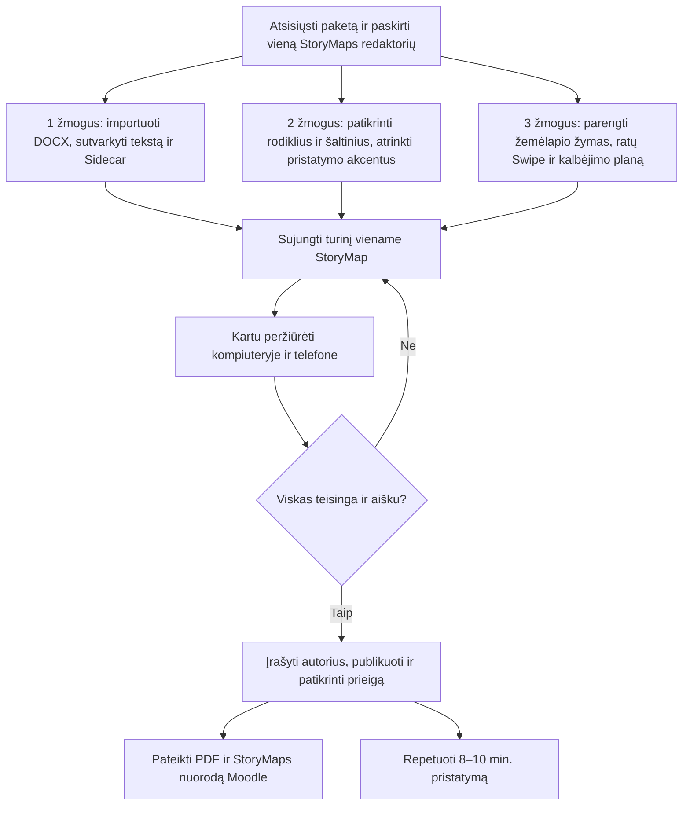

# StoryMaps surinkimo instrukcija

## Pradžia

Atsisiųskite [Word dokumentą](taivanas-kinija-storymaps.docx?raw=true). StoryMaps turinio lange pasirinkite **Create → Import document**, įkelkite failą ir palaukite būsenos **Draft**. Dokumentas mažesnis už oficialią 50 puslapių ribą. Importas yra beta funkcija, todėl peržiūrėkite lentelių ir paveikslėlių išdėstymą. [Oficiali Esri instrukcija](https://doc.esri.com/en/arcgis-storymaps/latest/get-started/author-and-publish-your-first-story.html).

Jei organizacija paslėpė beta funkciją, sukurkite paprastą Story ir tekstą kopijuokite iš [skaitomos versijos](pasakojimas-perziurai.md), o paveikslėlius įkelkite iš `assets/`.

## Darbų eiga ir lygiagretus darbas

Turinys, 28 rodikliai, skaičiavimai ir paveikslėliai šiame pakete jau paruošti. Trijų žmonių grupė likusius darbus gali pasidalyti taip:

Rodiklių patikrą ir pristatymo pasirengimą galima atlikti tuo pat metu, kol vienas žmogus tvarko StoryMaps. Jei redaktoriaus prieiga nesidalijama, kiti savo pataisas perduoda tam pačiam redaktoriui. Prieš pateikiant būtina bendra sujungto rezultato peržiūra.

## Rekomenduojama blokų seka

| Dalis | StoryMaps blokai | Paruoštas turinys |
|---|---|---|
| Viršelis | Cover | Pavadinimas „Taivano ir Kinijos darnios raidos palyginimas“, grupės narių vardai |
| Įžanga | Text + Map | Tikslas ir uždaviniai, geografinė orientacija |
| Taivanas | Sidecar, 2–3 skaidrės | DVT politika, sveikatos apsauga, švietimas ir energetika |
| Kinija | Sidecar, 2–3 skaidrės | Skurdo mažinimas, paslaugų aprėptis, regioniniai skirtumai |
| Rodiklių palyginimas | Heading + Text + Table + Image | Keturios sritys, visos 28 kriterijų poros, keturių rodiklių grafikas |
| Darnūs ratai | Swipe + Text | Du vienodo dydžio PNG, metodikos paaiškinimas |
| Išvados | Text | Prioritetai ir palyginimo ribos |
| Šaltiniai | Text / Credits | Literatūra ir rodiklių šaltiniai |

Kitos grupės pavyzdyje yra šalių `Sidecar`, du `Express map` blokai, rodiklių dalys ir ratų `Swipe`. Šią dalijimo logiką galima pritaikyti mūsų turiniui. DOCX importas pats nesukuria šio interaktyvaus išdėstymo.

## Žemėlapis

Sukurkite `Express map` ir pažymėkite Taivaną bei žemyninę Kiniją. Pradiniam vaizdui pasirinkite Rytų Aziją. Aprašyme aiškiai įrašykite, kad statistikos aprėptis neapima Honkongo ir Makao. Galima palikti ir paruoštą [orientacinį žemėlapį](../assets/rytu-azijos-zemelapis.png), tačiau interaktyvus žemėlapis padės susieti pasakojimą su vieta.

Naudokite geografinių vietų žymeklius, jei pasirinktas bazinis žemėlapis ribas vaizduoja kitaip nei jūsų statistinė aprėptis. Šaltinių geografinės ribos aprašytos duomenų priede.

## Ratų palyginimas

Į `Swipe` įkelkite [Taivano ratą](../assets/taivano-darnus-ratas.png) ir [Kinijos ratą](../assets/kinijos-darnus-ratas.png). Paveikslėlių matmenys, kriterijų eiliškumas ir skalė vienodi. Kairėje pažymėkite Taivaną, dešinėje Kiniją. Po bloku palikite metodikos ir skirtingų etalonų paaiškinimą.

## Prieš publikuojant

- Įrašyti tikrus grupės autorius, seminaro auditoriją ir laiką.
- Patikrinti, kad visi 28 kriterijai išliko ir jų metai matomi.
- Peržiūrėti mobilųjį ir kompiuterio maketą, nuorodas ir paveikslėlių aprašymus.
- Palikti nuorodas į duomenis bei literatūrą.
- Publikuoti su auditorijai tinkama prieiga ir patikrinti nuorodą atsijungus.
- Moodle įkelti reikiamą PDF ir StoryMaps nuorodą įrašyti komentare prie PDF. PDF pavadinimas: visų autorių pavardės, auditorija, laikas.

Užduoties PDF neapibrėžia tikslaus pateikiamo PDF turinio ar apimties. Word dokumentą galima išsaugoti PDF formatu; jei dėstytojas nurodė kitą pateikimo formą, taikoma jo instrukcija.

## Pristatymas per 8–10 minučių

1. 1 min. pasirinkimo pagrindimas ir tikslas.
2. 2 min. Taivano ir Kinijos DVT kontekstas.
3. 3 min. keturių sričių svarbiausi duomenys.
4. 2 min. ratų palyginimas ir metodika.
5. 1 min. išvados ir prioritetai.

Pirmadienio srautui pateikimo terminas 2026-12-05 23:59, pristatymas 2026-12-07. Trečiadienio srautui pateikimas 2026-12-07 23:59, pristatymas 2026-12-09.
